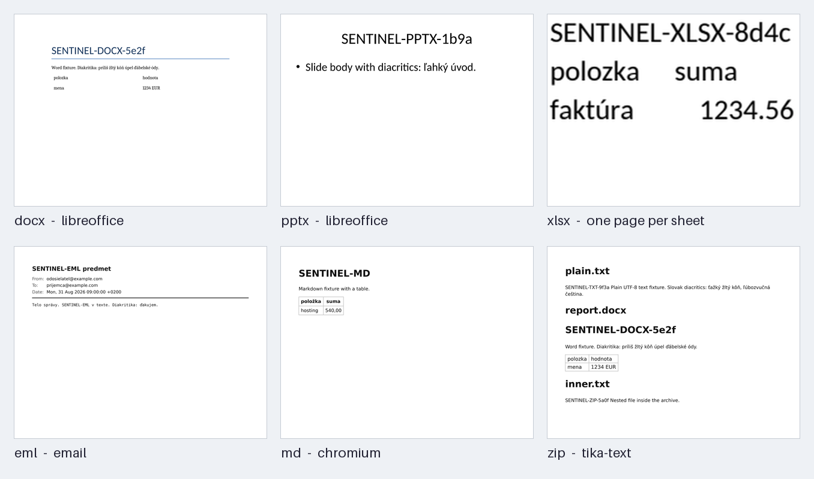
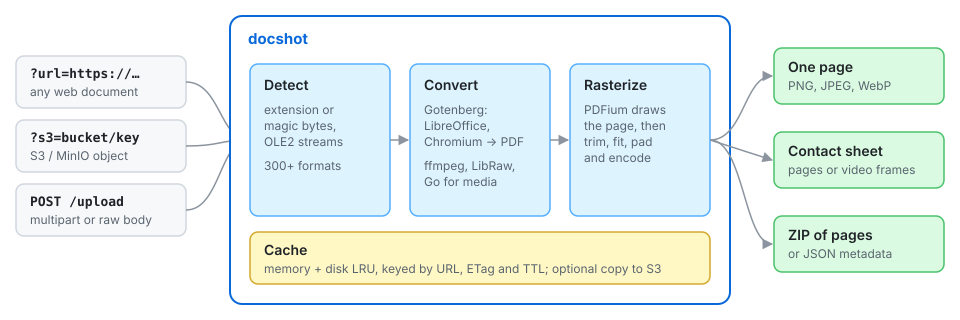

<h1 align=center>Dockette / Docshot</h1>

<p align=center>
   📸 One HTTP call turns any document, spreadsheet, deck, e-mail, archive, audio or video into a picture.
</p>

<p align=center>
🕹 <a href="https://f3l1x.io">f3l1x.io</a> | 💻 <a href="https://github.com/f3l1x">f3l1x</a> | 🐦 <a href="https://twitter.com/xf3l1x">@xf3l1x</a>
</p>

<p align=center>
  <a href="https://hub.docker.com/r/dockette/docshot/"></a>
  <a href="https://bit.ly/ctteg"></a>
  <a href="https://github.com/sponsors/f3l1x"></a>
</p>



-----

Docshot takes a document URL and returns an image, like an image proxy (imgproxy, Cloudinary) for documents.
Output is one page, a contact sheet, or a ZIP of all pages. It reads 300+ [formats](#formats): PDF, Office,
HTML, Markdown, e-mail, images, video, audio, archives, fonts. It runs self-hosted in one container.
Use cases: thumbnails, previews, input for vision LLMs.



## Quick start

```sh
docker run -d \
  -p 3000:3000 \
  -e DOCSHOT_FETCH_ALLOW='^https://example\.com/' \
  dockette/docshot
```

```html

```

## API

- `GET` endpoints read the document from a [source](#sources).
- `POST /upload` endpoints read it from the request body (a multipart file or a raw body).
- Parameters are listed under [common parameters](#common-parameters). An unknown or misplaced parameter is a `400`.
- Errors are JSON: `{"error", "code", "status"}`.

### GET /render

One page as PNG, JPEG or WebP.

| Extra parameter | |
|---|---|
| `time` | Video and audio frame: seconds (`42.5`) or a clock (`1:23`, `1:02:03`) |

```sh
curl 'localhost:3000/render?url=https://example.com/movie.mp4&time=1:23&width=640&format=webp' -o frame.webp
```

### GET /render/grid

A contact sheet of the pages.

| Extra parameter | |
|---|---|
| `grid` | `COLSxROWS`, each 1 to 10; default `auto` |
| `labels` | Page numbers; default `true` |

```sh
curl 'localhost:3000/render/grid?url=https://example.com/deck.pptx&grid=4x3' -o deck.png
```

### GET /render/pages

A ZIP with every page as an image.

| Extra parameter | |
|---|---|
| `limit` | 1 to 200 pages; default `20` |

```sh
curl 'localhost:3000/render/pages?url=https://example.com/report.docx&limit=50' -o report.zip
```

### GET /info

Document metadata as JSON. Takes source parameters only.

| Field | Present for |
|---|---|
| `name`, `bytes`, `type`, `route`, `cached` | all documents |
| `pages` | all except video |
| `page_sizes_pt` | documents converted to PDF (sizes in PDF points) |
| `width_px`, `height_px` | images, video |
| `files` | archives |
| `duration_s`, `codec` | audio, video |
| `fps` | video |
| `title`, `artist`, `album`, `sample_rate`, `channels`, `has_cover` | audio |

```sh
curl 'localhost:3000/info?url=https://example.com/report.docx'
```

### POST /upload

`POST /upload` (one page), `/upload/grid`, `/upload/pages` and `/upload/info` take the same parameters as
their `GET` counterparts, without the source parameters.

```sh
curl -F file=@report.docx localhost:3000/upload/pages -o report.zip
```

### GET /formats

All supported extensions as JSON.

```sh
curl localhost:3000/formats
```

### DELETE /cache

Drops the disk cache entries of one source (`?url=` or `?s3=`) or all entries (`?all=true`).
Returns `404` when the disk cache is off.

```sh
curl -X DELETE 'localhost:3000/cache?url=https://example.com/report.docx'
```

### Monitoring

| Endpoint | |
|---|---|
| `GET /healthz` | Liveness |
| `GET /readyz` | Readiness: Gotenberg and PDFium are up |
| `GET /version` | Release version |
| `GET /metrics` | Prometheus metrics |

```sh
curl localhost:3000/readyz
```

### Sources

| Parameter | Reads | Enabled by |
|---|---|---|
| `url=https://…` | an HTTP(S) URL | `DOCSHOT_FETCH_ALLOW=<regexp>` |
| `s3=bucket/key` | an S3 / MinIO object | `DOCSHOT_S3_*` |
| `name` | | Overrides the file name, and so the detected type |
| `v` | | Cache buster; also marks the response immutable |
| `sign` | | Signature, required when `DOCSHOT_SIGN_KEY` is set |
| `exp` | | Unix time the signed URL stops working; signed with the rest |

### Common parameters

| Parameter | |
|---|---|
| `page` | Page number; default `1` |
| `dpi`, `dpr` | Render resolution, device pixel ratio |
| `width`, `height`, `fit`, `position` | Output size and how the page fills it |
| `trim`, `pad`, `bg` | Cut margins, add padding, background colour |
| `format`, `quality` | `png`, `jpeg`, `webp` or `auto` (by the `Accept` header) |
| `preset` | `thumb`, `card`, `preview`, `og` or your own ([`DOCSHOT_PRESETS`](#presets)) |
| `store` | Save the result to S3: `s3`, `s3:append`, `s3:replace`, `s3:suffix`, `s3:hash` ([Storage](#storage)) |
| `fallback` | Return a placeholder image instead of an error |
| `download` | Send as an attachment, optionally with a file name |

## Storage

`?store=s3` saves the rendered result to S3 / MinIO.

- The response is still the image. The `X-Stored-As: s3://bucket/key` header names the object.
- A later request reuses a stored result made from the same source revision (S3 ETag, or content hash for
  other sources) without rendering. It answers with `X-Cache: store`.
- If the write fails, the image is still returned, with an `X-Store-Error` header.

Location:

- `?s3=` source: next to the source object.
- `?url=` and `POST /upload`: in `DOCSHOT_STORE_BUCKET`, under `DOCSHOT_STORE_PREFIX`, then the file name
  (for `?url=`: host and path).
- An upload without a file name always uses `hash`.
- The bucket must be in `DOCSHOT_S3_BUCKETS` when that is set.

Key layout: `?store=s3:<strategy>`, default `DOCSHOT_STORE_STRATEGY`.

| Strategy | `docs/report.docx` becomes |
|---|---|
| `append` | `docs/report.docx.png` (grid: `report.docx.grid.png`, pages: `report.docx.pages.zip`) |
| `replace` | `docs/report.png` |
| `suffix` | `docs/report_preview.png` (grid: `report_grid.png`, pages: `report_pages.zip`) |
| `hash` | `<prefix>_hash/ab/abcdef….png`; the same content gives the same object from any source |

Other options (`width`, `page`, `format`, ...) add a variant to the key, e.g. `docs/report.docx.p2-w300.webp`.

```sh
docker run -d \
  -p 3000:3000 \
  -e DOCSHOT_S3_ENDPOINT=minio:9000 \
  -e DOCSHOT_S3_ACCESS_KEY=... \
  -e DOCSHOT_S3_SECRET_KEY=... \
  -e DOCSHOT_STORE_BUCKET=previews \
  dockette/docshot

curl -i 'localhost:3000/render?s3=docs/report.docx&store=s3:replace&width=300&format=webp'
# X-Stored-As: s3://docs/report.p1-w300.webp
```

## Formats

`GET /formats` returns this list as JSON. Archives render each file inside through its own pipeline.

<details>
<summary>All 324 extensions</summary>

| Group | Extensions |
|---|---|
| PDF, XPS, DjVu | pdf oxps xps djv djvu |
| Word, presentations, drawings | 123 602 abw bib cdr cgm cmx cwk dbf dif doc docm docx dot dotm dotx dxf emf eps fb2 fodg fodp fodt hwp key lrf lwp mcw met mw odd odg odm odp odt otg oth otp ott pages pcd pct pdb pmd pot potm potx pps ppsm ppsx ppt pptm pptx psw pub pwp rtf sda sdd sdp sdw sgl smf std sti stw svm sxd sxg sxi sxm sxw vdx vor vsd vsdm vsdx vssx vstx wmf wpd wpg wps zabw |
| Spreadsheets | fods numbers ods ots pxl sdc slk stc sxc wb2 wk1 wks xls xlsb xlsm xlsx xlt xltm xltx xlw |
| Web, Markdown, SVG | htm html xhtml markdown md mdown mkd svg |
| E-mail, Outlook, EPUB | eml mbox mht mhtml msg epub |
| Data, calendars, contacts | csv tab tsv json geojson ipynb ics ifb vcf vcard dot gv |
| Images | avif bmp cur dds exr gif hdr heic heif ico j2k jfif jp2 jpeg jpf jpg jpx jxl pam pbm pcx pfm pgm png pnm ppm psd qoi ras rgb sgi sun tga webp xbm xpm xwd tif tiff |
| Camera RAW | 3fr arw cr2 cr3 crw dcr dng erf iiq kdc mrw nef nrw orf pef raf rw2 rwl sr2 srf srw x3f |
| Video | 3gp avi flv m2ts m4v mkv mov mp4 mpeg mpg mts ogv qt ts webm wmv |
| Audio | aac aif aiff amr ape flac m4a mid midi mka mp3 oga ogg opus wav wma wv |
| Fonts | otf ttc ttf woff woff2 |
| Archives | 7z bz2 cab cb7 cbr cbt cbz gz iso jar lz lz4 lzma rar tar tbz tbz2 tgz tlz txz tzst xz z zip zst tar.gz tar.xz tar.bz2 tar.zst |
| Text and code | adoc bash bat c cc cfg conf cpp cs css dart diff dockerfile env go gradle groovy h hpp ini java js jsonl jsx kt kts less log lua m makefile mjs ndjson org patch php pl properties ps1 py r rb rs rst scala scss sh sql srt svelte swift tex text toml ts tsx txt vtt vue xml yaml yml zsh |

</details>

## Configuration

All settings are environment variables. A value that does not parse (`DOCSHOT_TIMEOUT_SECONDS=3m`, `DOCSHOT_CACHE_TAGS=yes`)
stops docshot at startup with a message naming the setting.

> [!WARNING]
> There is no authentication by default. Keep docshot on a private network, or set `DOCSHOT_SIGN_KEY`.
> With a key, every endpoint that takes a document — `GET /render*`, `GET /info`, `POST /upload*` — and `DELETE /cache`
> needs a valid `?sign=` (HMAC-SHA256 of the path and query). Signed uploads take their parameters from the URL only;
> form fields are rejected. `docshot -sign '/render?url=…' -expires 24h` prints a signed URL that stops working after a day.

### General

| Env | Default | |
|---|---|---|
| `DOCSHOT_LISTEN` | `:3000` | Address of the HTTP server |
| `DOCSHOT_TIMEOUT_SECONDS` | `180` | Time limit of one request |
| `DOCSHOT_MAX_BYTES` | `100MB` | Largest source document (`KB`, `MB`, `GB`) |
| `DOCSHOT_CONCURRENCY` | number of CPUs | Renders and conversions at once |
| `DOCSHOT_QUEUE` | `64` | Requests waiting for a slot before `429` |
| `DOCSHOT_PDFIUM_WORKERS` | `4` | PDFium rasterizer workers |
| `DOCSHOT_FALLBACK` | `false` | Answer errors with a placeholder image by default |
| `DOCSHOT_SIGN_KEY` | – | Require signed URLs (see the warning above) |
| `DOCSHOT_UPLOAD_MEMORY` | `1GB` | Uploads held in memory at once; beyond it requests wait, then `429` |
| `DOCSHOT_LOG_FORMAT` | `text` | `text` or `json` |
| `GOTENBERG_INTERNAL_PORT` | `3001` | Port of the bundled Gotenberg |
| `GOTENBERG_URL` | `http://gotenberg:3000` | External Gotenberg; used only when the container is not started with Gotenberg's command line |

### Output

| Env | Default | |
|---|---|---|
| `DOCSHOT_DEFAULT_DPI` | `150` | Resolution of rendered pages |
| `DOCSHOT_DEFAULT_WIDTH` | `0` | Width when a request sets no size; `0` = by DPI |
| `DOCSHOT_DEFAULT_HEIGHT` | `0` | Height when a request sets no size; `0` = by DPI |
| `DOCSHOT_MAX_SIDE` | `10000` | Longest edge of an output image, in pixels |
| `DOCSHOT_MAX_PIXELS` | `40000000` | Area cap of any bitmap |

### Presets

| Env | Default | |
|---|---|---|
| `DOCSHOT_PRESETS` | – | Presets added to the built-in ones: `name:query;name:query`, e.g. `hero:width=1600&format=webp` |
| `DOCSHOT_ONLY_PRESETS` | `false` | Reject processing parameters; allow only `?preset=` |

### Cache

| Env | Default | |
|---|---|---|
| `DOCSHOT_CACHE_MB` | `256` | In-memory cache |
| `DOCSHOT_CACHE_DIR` | `/tmp/docshot` | Disk cache of rendered results; empty = off |
| `DOCSHOT_CACHE_SIZE` | `10GB` | Size limit of the disk cache |
| `DOCSHOT_CACHE_TTL` | `0` | Re-check the source after this (`90`, `12h`, `7d`); `0` = never |
| `DOCSHOT_CACHE_STALE` | `true` | After the TTL, answer from cache and re-check in the background |
| `DOCSHOT_CACHE_BUSTER` | – | Change it to invalidate all cached results |
| `DOCSHOT_CACHE_TAGS` | `false` | Send `Surrogate-Key` / `Cache-Tag` headers per source |
| `DOCSHOT_MAX_AGE` | `3600` | `max-age` of the `Cache-Control` header |
| `DOCSHOT_CACHE_CONTROL` | `public, max-age=<DOCSHOT_MAX_AGE>, stale-while-revalidate=86400, stale-if-error=604800` | The whole `Cache-Control` header |
| `DOCSHOT_CDN_MAX_AGE` | `0` | `CDN-Cache-Control` max-age; `0` = not sent |

### Sources

| Env | Default | |
|---|---|---|
| `DOCSHOT_FETCH_ALLOW` | – | Regexp of URLs `?url=` may fetch, anchored at the start; empty = `?url=` off. Loopback and link-local addresses are always refused |
| `DOCSHOT_S3_ENDPOINT` | – | S3 / MinIO endpoint; enables `?s3=` |
| `DOCSHOT_S3_ACCESS_KEY` | – | S3 access key |
| `DOCSHOT_S3_SECRET_KEY` | – | S3 secret key |
| `DOCSHOT_S3_REGION` | – | S3 region |
| `DOCSHOT_S3_SSL` | `true` | Use HTTPS to the S3 endpoint |
| `DOCSHOT_S3_BUCKETS` | – | Buckets `?s3=` may read; empty = all |

### Store

| Env | Default | |
|---|---|---|
| `DOCSHOT_STORE_BUCKET` | – | Bucket for `?store=s3` results that are not next to an S3 source ([Storage](#storage)) |
| `DOCSHOT_STORE_PREFIX` | `docshot/` | Key prefix of stored results |
| `DOCSHOT_STORE_STRATEGY` | `append` | Default key layout: `append`, `replace`, `suffix` or `hash` |

## How it works

- A Go server listens on `:3000`. It runs [Gotenberg](https://gotenberg.dev) in the same container.
- Documents are converted to PDF (LibreOffice, Chromium). PDFium renders the page.
- Images, video and audio go through Go and ffmpeg.
- Truncated or corrupted images show the part that survived, as in a browser.
- JavaScript and network access are off for untrusted input.

## Development

```sh
make up          # build + start on :9994
make test-unit   # go vet + unit tests
make lint        # gofmt, staticcheck, govulncheck, shellcheck, hadolint
make smoke       # render one page with the built image
make test        # end-to-end checks
```

Releases are dated `YYYY.MM.DD` (see [`VERSION`](VERSION)). Image tags:

| Tag | |
|---|---|
| `latest` | Latest `master` |
| `2026.10.19` | A release; pin this |
| `sha-<sha>` | Exact commit |

To release: run `make release`, commit and push. CI publishes the image and the GitHub release.

See [how to contribute](https://contributte.org/contributing.html) to this package.

This package is currently maintaining by these authors.

<a href="https://github.com/f3l1x">
    
</a>

-----

Consider to [support](https://github.com/sponsors/f3l1x) **f3l1x**. Also thank you for using this package.
